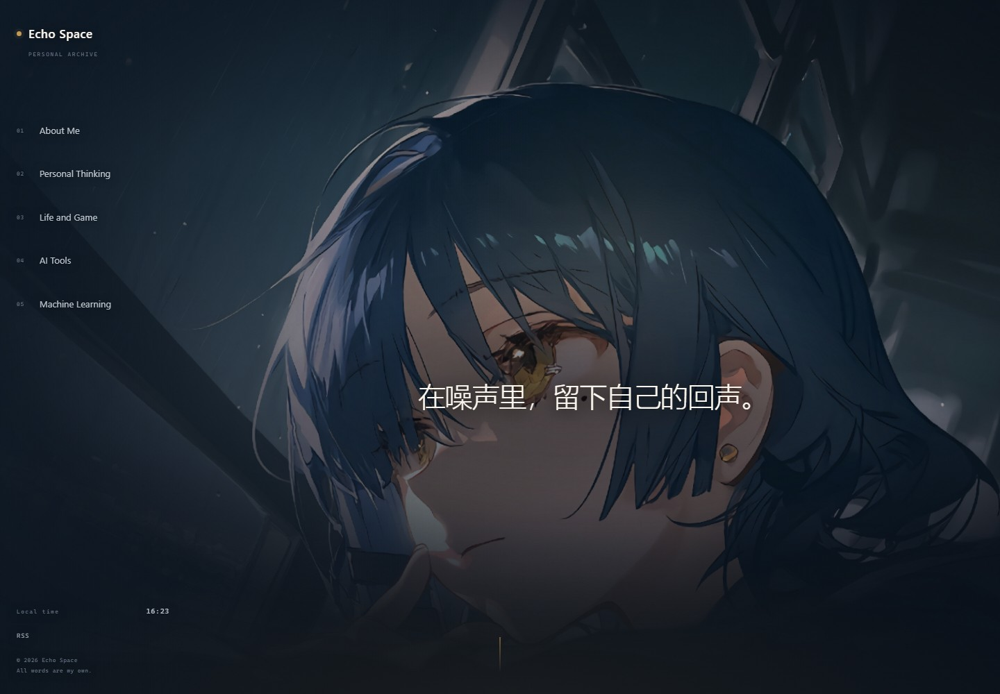

# Echo Space

一个本地优先的个人博客。深蓝夜色、黄铜金，以及一张铺满首屏的主图。



- 纯静态输出，没有数据库，没有外部服务。
- 首屏为整屏主图，一行文字居中偏下、逐字出现。
- 内容保存在普通的 Markdown / JSON 文件里，随时可以用 VS Code 直接改。
- 本地自带编辑模式与 Studio，改文字、换图、写文章都不用碰代码。
- 暂不部署，只在电脑本地运行。

> 每个文件做什么、想改东西去哪里，见 [docs/PROJECT-STRUCTURE.md](docs/PROJECT-STRUCTURE.md)。

## 快速开始

需要 Node.js 20 或更高版本。

```bash
npm install
npm run dev
```

打开：<http://127.0.0.1:4321>

停止服务：在终端按 `Ctrl + C`。

## 两种编辑方式

### 1. 在页面上直接改

打开任意页面，点击右下角「编辑页面」，或按 `Ctrl + E`。

- 带虚线框的文字可以直接点击修改；
- 改完点「保存并退出」，页面会自动刷新；
- 首屏图片、遮罩浓度、画面焦点，通过「更换图片 / 调整遮罩」修改；
- `Ctrl + E` 也会保存并退出。

只对本地开发服务器生效，构建后的静态站点没有这个入口。

### 2. Studio

打开 <http://127.0.0.1:4321/studio/>：

- **文章**：新建、编辑、删除、草稿、分类、标签、封面、Markdown 正文；
- **站点**：站名、作者、描述、首屏主图与文案、左侧导航名称、社交链接；
- **关于我**：头像、简介、Now、工具箱、时间线、兴趣、社交链接。

Studio 里的修改同样直接写入项目文件。文章保存后可以在新标签页预览。

## 内容放在哪

```text
src/
  data/
    site.json         站点名称、首屏、导航、社交链接
    profile.json      关于我页面的全部资料
  content/posts/
    thinking/         Personal Thinking
    life/             Life and Game
    ai-tools/         AI Tools
    ml/               Machine Learning
  pages/              页面路由
  components/         页面组件
  styles/global.css   设计变量与全站样式
  styles/studio.css   Studio 样式
  integrations/
    studio-api.mjs    本地编辑接口（只在 npm run dev 时存在）
public/
  uploads/            首屏主图、封面、头像
assets/source/        你提供的原始图片（2560×1600）
docs/                 README 预览图
```

### 手写一篇新文章

在对应分类文件夹里新建一个 `.md` 文件，例如 `src/content/posts/thinking/my-note.md`：

```yaml
---
title: 标题
description: 一两句摘要
date: 2026-10-28
category: thinking
tags: [思考, 写作]
featured: false
draft: false
---

正文从这里开始。
```

`category` 必须是 `thinking`、`life`、`ai-tools`、`ml` 之一，并且与所在文件夹一致。

### 草稿

在 Frontmatter 里写 `draft: true`，或在 Studio 勾选「草稿」，文章不会出现在页面、RSS 和搜索里。

## 换首屏图片

当前主图：`public/uploads/echo-space-hero.jpg`（来自 `assets/source/echo-space-hero-original.jpg`，2560×1600）。

推荐直接：

1. `npm run dev`；
2. 进入编辑模式；
3. 点「更换图片」，选一张更大的图；
4. 调整遮罩和焦点，保存。

也可以用同名文件覆盖 `public/uploads/echo-space-hero.jpg`。建议使用**横图（16:10）、至少 1920px 宽**；图片会以 `cover` 铺满整个首屏，其他比例也能用，但 16:10 的构图最完整。

首屏不是简单的平铺：图片带有极轻的透视倾斜，边缘由径向渐变、底部渐隐和暗角收进页面背景。页面上只有一行文字，加载后逐字出现，保留一个闪烁的光标；开启系统“减少动态效果”时会直接显示整句。

## 改颜色

全站颜色集中在 `src/styles/global.css` 顶部的 `:root`：

```css
--bg: #0a111a;
--ink: #f4efe7;
--accent: #c49a55;        /* 黄铜金 */
--accent-soft: #e0be80;
--accent-deep: #233f50;   /* 深钢蓝，用于实心按钮 */
```

这组颜色来自那张主图：深蓝头发、暗色背景、金色眼睛。改这几个变量就能整体换色调。

## 构建与预览

```bash
npm run build
npm run preview
```

构建产物在 `dist/`。`/studio` 页面会一起构建，但本地编辑接口不会——部署到静态空间后，文章编辑功能不可用。这是有意的设计。

## 本地编辑接口的安全边界

- 只在 `astro dev` 中注册，构建后不存在；
- 服务绑定 `127.0.0.1`，并校验请求来源必须是 localhost；
- 图片类型、大小、文件路径都有校验；
- 不包含任何账号系统。

不要把这个开发服务器暴露到公网。

## 之后要推到 GitHub

目前没有远程仓库，也没有做部署。需要时：

```bash
git remote add origin <你的仓库地址>
git push -u origin main
```

如果要部署到 GitHub Pages，还需要另外配置静态托管的 base path，并把 `astro.config.mjs` 里的 `site` 改成线上地址。

## 技术栈

- [Astro 5](https://astro.build/) — 静态站点、内容集合、Markdown
- 原生 CSS + 少量原生 TypeScript，没有前端框架
- 本地编辑接口基于 Vite 中间件与 Node.js 文件系统

## 常用命令

| 命令 | 作用 |
| --- | --- |
| `npm run dev` | 本地开发，<http://127.0.0.1:4321> |
| `npm run build` | 生成静态站点到 `dist/` |
| `npm run preview` | 预览构建结果 |
| `/studio/` | 本地内容管理 |
| `Ctrl + E` | 进入 / 保存并退出页面编辑 |
